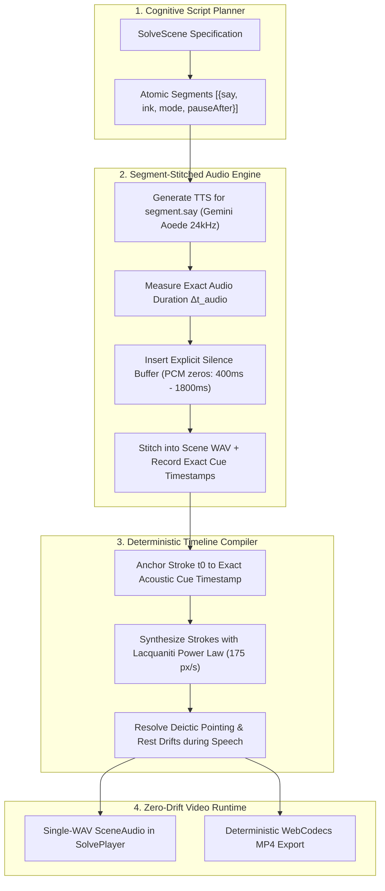

# Whiteboard Teaching Synchronization Master Plan
## Achieving True Human-Natural Pacing and Audio-Visual Coordination in Ember

---

## 1. Executive Summary & Problem Diagnosis

### The Core Defect
When viewing generated whiteboard videos in [`SolvePlayer`](file:///c:/Users/Michael/Ember/src/components/player/SolvePlayer.tsx), the experience suffers from three severe flaws:
1. **Voice Rushing**: The narrator delivers dense university mathematics at an unbroken, relentless ~160 WPM without pedagogical pauses or breathing gaps.
2. **Loss of Synchronization**: Whiteboard ink either races ahead, lags far behind, or writes completely out of phase with spoken words.
3. **Artificial Tutoring Feel**: The engine treats whiteboard generation like "karaoke" (forcing the pen to write continuously while the voice speaks continuously), rather than cycling through authentic cognitive tutoring modes.

### Ground-Truth Code Autopsy
A thorough investigation of the codebase reveals the exact architectural mechanisms responsible:

| Component | Code Location | Mechanism & Failure Mode |
| :--- | :--- | :--- |
| **Monolithic Narration** | [`prompts.ts:103`](file:///c:/Users/Michael/Ember/src/lib/prompts.ts#L103) & [`audio-assets.ts:18`](file:///c:/Users/Michael/Ember/src/lib/jobs/audio-assets.ts#L18) | The entire 600–750 character scene script is passed as a single string to Gemini TTS. Gemini treats it as continuous audiobook prose, removing natural pause boundaries. |
| **Character-Count Timing** | [`compile.ts:1918-1924`](file:///c:/Users/Michael/Ember/src/lib/video/compile.ts#L1918-L1924) | `windowFor = (span * (s.r1 - s.r0)) / totalChars`. Stroke start times and segment windows are allocated by raw string character count, completely blind to phoneme lengths, syllable counts, and spoken math complexity. |
| **Linear Scale Drift** | [`compile.ts:2191-2203`](file:///c:/Users/Michael/Ember/src/lib/video/compile.ts#L2191-L2203) | `setSceneAudio` calculates a single scalar $k = \frac{\text{audioDur} + 0.5 - \text{HEAD}}{\text{base} + 0.5 - \text{HEAD}}$ and uniformly multiplies all stroke start times `st.t0 = anchor(st.t0)` across the entire scene. Any localized pause or speed variation destroys sync for all subsequent strokes. |
| **Brittle `say` Tag Dropping** | [`solve-schema.ts:188-208`](file:///c:/Users/Michael/Ember/src/lib/solve-schema.ts#L188-L208) | `cleanSay` drops the `say` sync tag entirely if a contiguous 3+ word substring match fails against `narrationKey`. When tags drop, the scene falls back to arbitrary unaligned pacing. |

---

## 2. Key Architectural Takeaways from `notes-to-video`

From our code inspection of [`cymcymcymcym/notes-to-video`](https://github.com/cymcymcymcym/notes-to-video), four foundational principles stand out that directly solve Ember's bottlenecks:

1. **Sentence/Chunk Audio Generation (`_split_sentences`)**:
   Instead of generating a massive paragraph, audio is synthesized in atomic sentence units. This gives exact, millisecond-accurate audio lengths for every single thought.
2. **Explicit Silence Buffers (`GAP_MS = 350`, `SCENE_GAP_MS = 500`)**:
   Pauses are **not** left to the whims of the TTS model. They are explicitly stitched into the audio track. This drops effective speech rate from 165 WPM to a calm, authoritative 115 WPM.
3. **Inline Cue Anchors (`{CUE}`)**:
   Visual triggers are embedded directly into narration sentences rather than decoupled in a parallel array, eliminating fragile fuzzy-string search failures.
4. **Independent Physical Motion (`until` and `sync`)**:
   Handwriting kinematics are decoupled from speech duration. The hand writes at invariant biological velocity ($v \sim 175\text{ px/s}$), and the engine inserts writing silence or pointer hovers to balance the timeline.

---

## 3. The New Cognitive Whiteboard Architecture



### The 5 Cognitive Tutoring Modes
Every beat/segment in the script will declare or map to an explicit cognitive mode:

1. **Mode 1: Speak-Ahead (Concept Framing)**:
   - *Behavior*: Professor Ember speaks the guiding thought (*"Now let's examine why substitution fails..."*).
   - *Board*: **Still**. Pen is either resting or gently hovering.
   - *Audio*: Full sentence plays.
2. **Mode 2: Write-Ahead (Symbolic Staging)**:
   - *Behavior*: Professor writes the equation in focused silence (*"∫ x·e^(2x) dx"*).
   - *Board*: Pen writes at natural chalk speed ($175\text{ px/s}$).
   - *Audio*: Dedicated chalk-writing pause ($1.2\text{s} - 2.0\text{s}$).
3. **Mode 3: Parallel Working (Low-Load Algebra)**:
   - *Behavior*: Simple operations where writing and speaking naturally coincide (*"du equals dx"*).
   - *Board*: Pen writes synchronously with speech.
4. **Mode 4: Deictic Referencing (Gesture & Deconstruction)**:
   - *Behavior*: Professor references an existing term (*"Notice the x term right here..."*).
   - *Board*: Pen hovers lifted ($z \ge 16\text{px}$) with pointer beacon at target coordinate.
5. **Mode 5: Pedagogical Silence (Cognitive Absorption)**:
   - *Behavior*: Final boxed answer or major theorem conclusion.
   - *Board*: Clean boxed answer displayed.
   - *Audio*: $1.8\text{s} - 2.5\text{s}$ absorption silence before wrap-up or scene cut.

---

## 4. Phase-by-Phase Implementation Blueprint

### Phase 1: The Segment-Stitched Audio Engine
**Files to Modify:**
- [`src/lib/video/types.ts`](file:///c:/Users/Michael/Ember/src/lib/video/types.ts)
- [`src/lib/jobs/audio-assets.ts`](file:///c:/Users/Michael/Ember/src/lib/jobs/audio-assets.ts)
- [`src/lib/tts-queue.ts`](file:///c:/Users/Michael/Ember/src/lib/tts-queue.ts)
- [`src/lib/ai/gemini.ts`](file:///c:/Users/Michael/Ember/src/lib/ai/gemini.ts)

**Key Changes:**
1. **Extend `SceneSegment` in `types.ts`**:
   ```typescript
   export interface SceneSegment {
     say: string;
     ink?: Beat[];
     mode?: "speak_ahead" | "write_ahead" | "parallel" | "point" | "pause";
     pauseAfter?: number; // explicit silence buffer in seconds
   }
   ```
2. **Implement Audio Stitcher with Silence Buffers**:
   - In `audio-assets.ts`, implement `synthesizeSegmentedAudio(segments, voice)`.
   - For each segment:
     - Run `normalizeSpokenMath(segment.say)`.
     - Synthesize 24kHz 16-bit mono PCM via `geminiTTS`.
     - Calculate segment audio duration: `dur = pcm.length / (24000 * 2)`.
     - Determine inter-segment silence buffer (default 400ms for intra-thought, 1200ms–1800ms for writing transitions, 2000ms for boxed answers).
     - Generate silence PCM buffer: `Buffer.alloc(Math.round(pauseSec * 24000 * 2))`.
     - Record exact cumulative start/end timestamps for each segment.
   - Concatenate all segment PCMs and silence buffers into a single scene WAV with a valid 44-byte RIFF header.
   - Return `{ key, buffer, ms, segmentTimings: Array<{ idx, t0, t1, audioDur }> }`.

**Invariant Guaranteed:**
The output is still a **single standard WAV file per scene**, ensuring 100% compatibility with [`SolvePlayer.tsx`](file:///c:/Users/Michael/Ember/src/components/player/SolvePlayer.tsx) and [`export-mp4.ts`](file:///c:/Users/Michael/Ember/src/lib/video/export-mp4.ts), while the audio itself now has human breathing and writing pauses baked in.

---

### Phase 2: Compiler Timeline Pacing Refactor
**Files to Modify:**
- [`src/lib/video/compile.ts`](file:///c:/Users/Michael/Ember/src/lib/video/compile.ts)
- [`src/lib/video/timings.ts`](file:///c:/Users/Michael/Ember/src/lib/video/timings.ts)

**Key Changes:**
1. **Eliminate Character-Count Guessing (`windowFor`)**:
   - In `compile.ts`, replace the `(span * (s.r1 - s.r0)) / totalChars` proportional allocation.
   - When segment timings are available from stitched audio, map each beat's start time $t_0$ directly to its segment's acoustic start time $T_{\text{segment}}[i]$.
2. **Abolish Uniform Linear Scaling in `setSceneAudio`**:
   - In [`compile.ts:2176-2225`](file:///c:/Users/Michael/Ember/src/lib/video/compile.ts#L2176-L2225):
   - Replace the global multiplier $k$ with segment-anchored placement:
     - Each segment's strokes are anchored to that segment's known audio start.
     - Stroke durations retain their biological kinematic duration from [`KinematicStrokeSynthesizer`](file:///c:/Users/Michael/Ember/src/lib/video/kinematics.ts#L253).
     - Strokes are never artificially squashed below $0.85\times$ or stretched above $1.15\times$.
3. **Deictic Pointer Alignment**:
   - When a segment is marked `mode: "point"` or has a `{ type: "point" }` beat, the pointer hovers over the target group exactly for the duration of that segment's spoken audio.

---

### Phase 3: Script & Prompt Contract Refactor
**Files to Modify:**
- [`src/lib/prompts.ts`](file:///c:/Users/Michael/Ember/src/lib/prompts.ts)
- [`src/lib/solve-schema.ts`](file:///c:/Users/Michael/Ember/src/lib/solve-schema.ts)
- [`src/lib/samples.ts`](file:///c:/Users/Michael/Ember/src/lib/samples.ts)

**Key Changes:**
1. **Prompts Update (`WRITER_SYSTEM` & `TRANSCRIPT_PROMPT`)**:
   - Explicitly instruct the AI to output structured `segments`:
     - Spoken lead-in (framing thought with no ink).
     - Inscription segment (formula written with natural explanation or chalk silence).
     - Coda / reflection (verbal insight while marker rests/points).
2. **Schema Sanitization (`cleanSay` & `validateScript`)**:
   - Support `segments` directly in JSON schema validation.
   - When a script provides `segments`, preserve the 1-to-1 relationship between `say` and `ink` so zero tags are lost.
3. **Update Curated Master Samples (`SAMPLE_CALCULUS`)**:
   - Restructure [`SAMPLE_CALCULUS`](file:///c:/Users/Michael/Ember/src/lib/samples.ts#L15) with explicit `segments` and cognitive modes.
   - Verify that integration by parts demonstrates textbook Khan Academy / Organic Chemistry Tutor pacing.

---

### Phase 4: Verification, Auditing & Golden Demo Test
**Testing Protocol:**
1. **Compilation & Unit Tests**:
   - Run `bun test tests/pen-pacing.test.ts` and ensure all kinematic bounds hold.
   - Run `bun x tsc --noEmit` to verify strict TypeScript safety.
2. **Acoustic Waveform Inspection**:
   - Verify that generated WAV files contain genuine silence gaps (RMS amplitude < 0.001 during pause windows) rather than continuous unbroken speech.
3. **Audio-Visual Frame Verification**:
   - Play the flagship calculus video on `http://localhost:3001/studio`.
   - Visually audit:
     - Does the professor speak first while the board is calm?
     - Does the hand start writing at the exact moment the equation is introduced?
     - Does the pointer hover cleanly over referenced terms?
     - Does the final boxed answer hold in silence for 2.0s before ending?
4. **MP4 Export Verification**:
   - Trigger MP4 export in Chrome/Edge.
   - Confirm exported MP4 has zero audio-video drift from start to finish.

---

## 5. Risk Assessment & Fallbacks

| Risk | Mitigation |
| :--- | :--- |
| **TTS Rate Limits (429) during multi-segment generation** | Serialize calls through [`tts-queue.ts`](file:///c:/Users/Michael/Ember/src/lib/tts-queue.ts) with adaptive backoff. For curated/cached samples, pre-bake the stitched audio keys in `samples.ts`. |
| **Old Scripts without `segments`** | Keep the fallback sentence splitter: if a scene only has monolithic `narration`, split it by sentence punctuation (`[.!?]`), assign beats greedily to sentences, and apply the segmented stitcher automatically. |
| **Short Audio vs Long Writing** | If an equation physically takes 3.5s to write at 175 px/s, but the voice is only 1.5s, the engine expands the segment's trailing pause buffer to $3.5\text{s} + 0.3\text{s}$, letting the teacher finish writing in silence before starting the next sentence. |

---

## 6. Execution Decision Gate

With this grounded exploration complete, we are ready to proceed with implementation.
- **Recommended First Action**: Refactor the audio synthesis pipeline (`audio-assets.ts`) to support segment stitching with silence buffers, and test on the flagship calculus lesson.
